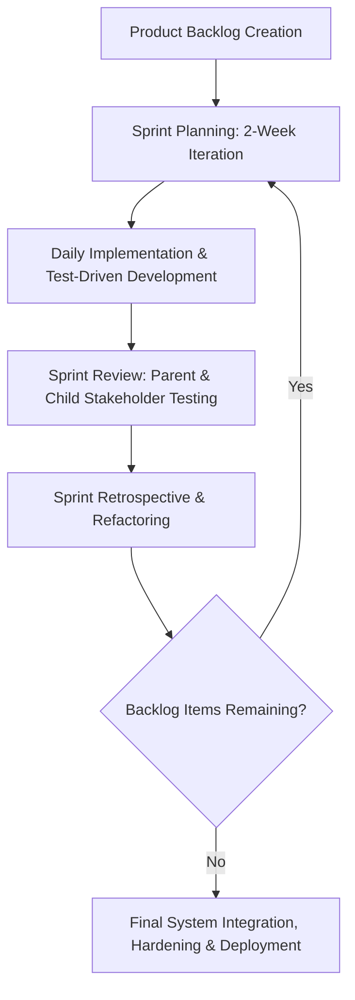
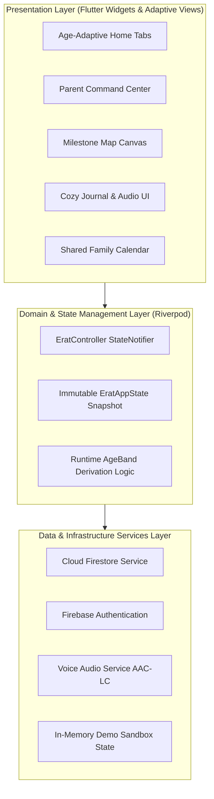
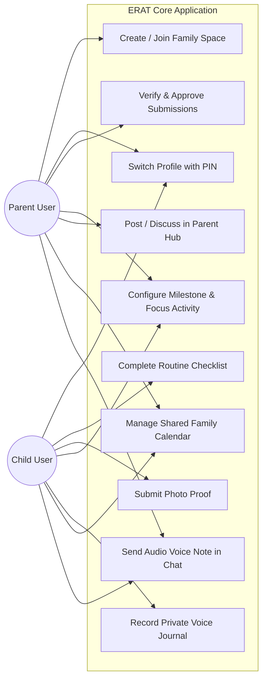
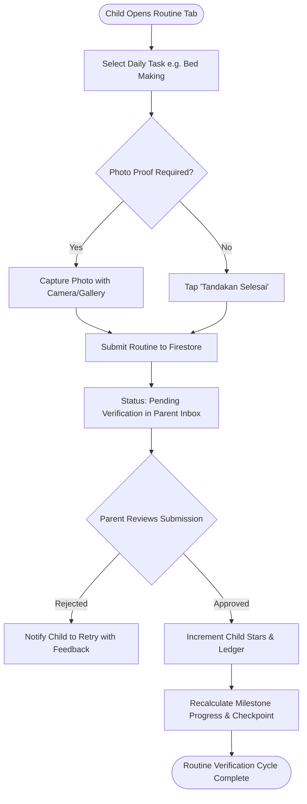
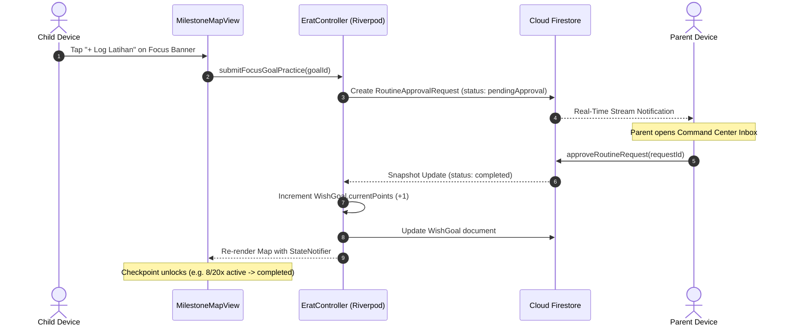
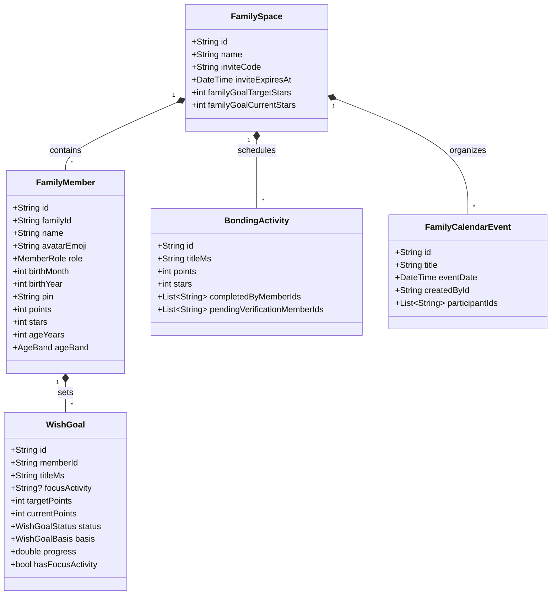
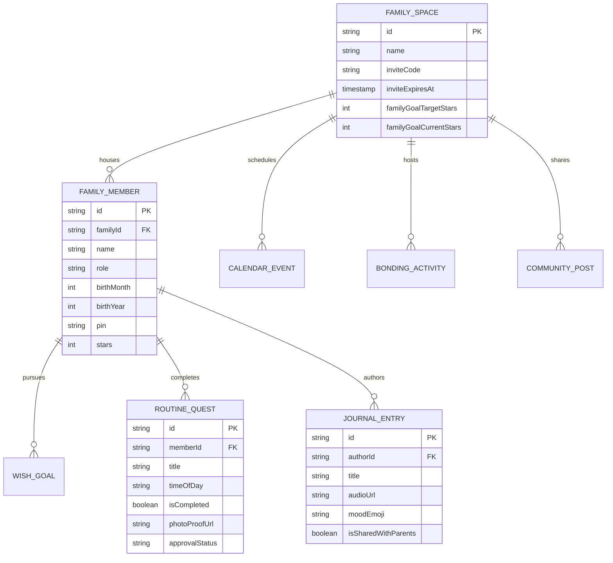

# ERAT FYP — Step-by-Step Image & Diagram Insertion Guide

> **Final Year Project (FYP):** Bachelor of Science in Information Technology  
> **Project Title:** ERAT: A Gamified Mobile Application for Family Bonding and Habit Formation  
> **Student:** Khadijah Binti Kasiran (`B24070074`)  
> **Supervisor:** Ms Nurulaini | **Dean/Coordinator:** Ms Sarmila Devi  
> **Target Document:** [`ERAT_FYP_Full_Documentation.md`](../ERAT_FYP_Full_Documentation.md)

---

## 📌 Executive Summary

Your FYP documentation now contains clear, standardized **Image Placeholder Boxes** and rendered visual links for all **13 figures** and **13 tables**. 

The figures are organized into two groups:
1. **Group A: 8 Technical & UML Diagrams (Figures 1.1, 3.1, 4.1, 4.2, 4.3, 4.4, 4.5, 4.6)**  
   *Status:* **ALL 8 ARE ALREADY RENDERED AS HIGH-RES PNGs** and stored in your repository at [`docs/figures/`](./figures/)! You can view them directly, embed them in Word, or re-render them anytime using the Mermaid code provided.
2. **Group B: 5 UI Screen Mockups (Figures 4.7, 4.8, 4.9, 4.10, 4.11)**  
   *Status:* Ready for you to capture from your physical phone (or Android emulator) running the app in **Demo Sandbox Mode** using the recipes below.

---

## 🎨 Group A: Diagrams & UML Flowcharts (Instant Render via Mermaid)

For each diagram below:
1. Open [https://mermaid.live](https://mermaid.live) in your web browser.
2. Copy the Mermaid code from the document or from the table below and paste it into the left code panel.
3. Click **"Actions"** (or the download icon) ➔ **"PNG"** (choose 2048px or high-res) ➔ Save to your computer.
4. Insert the PNG image into your Word/PDF document right above the caption.

---

### 1. Figure 1.1: Project Timeline and Sprint Milestones Gantt Chart
- **Location:** Chapter 1, Section 1.6 (Project Planning and Gantt Chart)
- **Caption:** *Figure 1.1: Project Timeline and Sprint Milestones Gantt Chart across 14-Week Development Period.*
- **Orientation:** Landscape (16:9, ~1920 × 1080 px)
- **Mermaid Code:**
```mermaid
gantt
    title ERAT Final Year Project Development Timeline
    dateFormat  YYYY-MM-DD
    section Phase 1: Planning
    Literature Review & Ideation     :done, p1, 2026-08-15, 2026-09-05
    Requirements Elicitation         :done, p2, 2026-09-01, 2026-09-12
    section Phase 2: Design
    System Architecture & UML        :done, p3, 2026-09-13, 2026-09-26
    Database Modeling & Security Rules:done, p4, 2026-09-20, 2026-10-03
    UI/UX Mockups & Palette Design   :done, p5, 2026-09-27, 2026-10-10
    section Phase 3: Implementation
    Sprint 1: Core Auth & Demo Mode  :done, p6, 2026-10-04, 2026-10-17
    Sprint 2: Routines & Quests      :done, p7, 2026-10-18, 2026-10-31
    Sprint 3: Milestones & Voice Note:done, p8, 2026-11-01, 2026-11-14
    Sprint 4: Calendar & Community   :done, p9, 2026-11-08, 2026-11-20
    section Phase 4: Testing & Eval
    Unit & Integration Testing       :done, p10, 2026-11-15, 2026-11-21
    UAT & SUS User Evaluation        :active, p11, 2026-11-18, 2026-11-24
    section Phase 5: Documentation
    Report Writing & Final Polish    :active, p12, 2026-11-10, 2026-11-28
```

---

### 2. Figure 3.1: Agile Scrum Iterative Development Lifecycle Flowchart
- **Location:** Chapter 3, Section 3.2 (Software Development Lifecycle: Agile Scrum)
- **Caption:** *Figure 3.1: Agile Scrum Iterative Development Lifecycle Flowchart showing Sprint Execution and Stakeholder Feedback Loops.*
- **Orientation:** Vertical / Flowchart (~1200 × 1600 px)
- **Mermaid Code:**


---

### 3. Figure 4.1: Clean Architecture 3-Tier Layered Package Structure
- **Location:** Chapter 4, Section 4.1 (Architectural Overview)
- **Caption:** *Figure 4.1: Clean Architecture 3-Tier Layered Package Structure showing Presentation, Riverpod Logic, and Data Services.*
- **Orientation:** Landscape (~1600 × 1000 px)
- **Mermaid Code:**


---

### 4. Figure 4.2: Complete System UML Use Case Diagram
- **Location:** Chapter 4, Section 4.2.1 (Use Case Diagram)
- **Caption:** *Figure 4.2: Complete System UML Use Case Diagram delineating Parent and Child Actor Boundaries.*
- **Orientation:** Landscape (~1800 × 1200 px)
- **Mermaid Code:**


---

### 5. Figure 4.3: UML Activity Diagram: Child Routine Submission and Parent Verification Flow
- **Location:** Chapter 4, Section 4.2.2 (Activity Diagram)
- **Caption:** *Figure 4.3: UML Activity Diagram: Child Routine Submission and Parent Verification Flow.*
- **Orientation:** Vertical Swimlane / Flow (~1400 × 1800 px)
- **Mermaid Code:**


---

### 6. Figure 4.4: UML Sequence Diagram: Focus Activity Milestone Checkpoint Progression
- **Location:** Chapter 4, Section 4.2.3 (Sequence Diagram)
- **Caption:** *Figure 4.4: UML Sequence Diagram: Focus Activity Milestone Checkpoint Progression showing Asynchronous Riverpod-to-Firestore Messages.*
- **Orientation:** Landscape (~1800 × 1100 px)
- **Mermaid Code:**


---

### 7. Figure 4.5: UML Domain Class Diagram for ERAT Application Entities
- **Location:** Chapter 4, Section 4.2.4 (Domain Class Diagram)
- **Caption:** *Figure 4.5: UML Domain Class Diagram for ERAT Application Entities showing Multiplicity and Aggregations.*
- **Orientation:** Landscape (~1600 × 1200 px)
- **Mermaid Code:**


---

### 8. Figure 4.6: Cloud Firestore Multi-Tenant Entity-Relationship Model
- **Location:** Chapter 4, Section 4.3 (Database Architecture and Security Rules)
- **Caption:** *Figure 4.6: Cloud Firestore Multi-Tenant Entity-Relationship Model showing Collection Hierarchies.*
- **Orientation:** Landscape (~1600 × 1100 px)
- **Mermaid Code:**


---

## 📱 Group B: UI Screenshots (Capture from Your Device in Demo Mode)

To capture these screenshots:
1. Run the app: `flutter run` on your connected physical Android phone or emulator.
2. Follow the exact screen recipe below.
3. Tip: For clean presentation, take screenshots in portrait orientation. You can use free mockup tools like [mockuphone.com](https://mockuphone.com) or [shots.so](https://shots.so) to wrap the screenshot in a sleek mobile bezel if desired, or place the raw crop directly in Word.

---

### 9. Figure 4.7: Screen Layout: Authentication, Onboarding, and Demo Switcher
- **Location:** Chapter 4, Section 4.4.1
- **Caption:** *Figure 4.7: Screen Layout: Authentication, Family Onboarding, and Instant Demo Sandbox Switcher.*
- **How to Capture:**
  1. Open the app fresh (or log out / clear storage).
  2. You will see the Welcome / Authentication screen (`AuthFamilyScreen`).
  3. Ensure the Family Space Name field, Invite Code button, and the **"Cuba Mod Demo" / "Try Demo Mode"** button are visible.
  4. Take a screenshot (Power + Volume Down on Android).

---

### 10. Figure 4.8: Screen Layout: Parent Command Center vs. Child Routine Timeline
- **Location:** Chapter 4, Section 4.4.2
- **Caption:** *Figure 4.8: Screen Layout: Parent Command Center (Left) vs. Child Routine Timeline (Right).*
- **Format:** Place two screenshots side-by-side in Word/Docs.
- **How to Capture:**
  - **Left Screenshot (Parent Command Center):**
    1. In Demo Mode, switch active profile to **Parent (Ibu / Ayah)**.
    2. Enter PIN if prompted (`1234`).
    3. Stay on the Home tab showing the Parent Command Center, pending approval requests, and Star Ledger adjustments. Capture screen.
  - **Right Screenshot (Child Routine Timeline):**
    1. Tap the profile switcher (top bar) and select a child profile (e.g. **Adik / Junior Adventurer**).
    2. Stay on the Home tab showing the routine blocks (Pagi / Petang / Malam), routine check-in buttons, and photo upload triggers. Capture screen.
  - Combine or insert both side-by-side in your Word table.

---

### 11. Figure 4.9: Screen Layout: Gamified Milestone Trail with Focus Activity Banner
- **Location:** Chapter 4, Section 4.4.3
- **Caption:** *Figure 4.9: Screen Layout: Gamified Milestone Trail with Focus Activity Repetitive Progress Banner.*
- **How to Capture:**
  1. While in a Child profile (e.g., Young Cadet / Goal Achiever), tap the **"Ganjaran" / "Milestone"** tab in the bottom navigation bar.
  2. The screen displays the winding adventure path with checkpoints (20%, 40%, 60%, 80%, 100%), the child avatar, and the **Focus Activity Banner** (e.g., *Hafazan Doa / Bacaan 20x* with the `+ Log Latihan` button).
  3. Take a screenshot of this full screen.

---

### 12. Figure 4.10: Screen Layout: Child Audio Journal vs. Parent Community Forum
- **Location:** Chapter 4, Section 4.4.4 & 4.4.5
- **Caption:** *Figure 4.10: Screen Layout: Child Private Audio Journal (Left) vs. Parent Community Forum (Right).*
- **Format:** Place two screenshots side-by-side.
- **How to Capture:**
  - **Left Screenshot (Child Journal):**
    1. Switch to a teen/child profile (e.g. **Kakak / My Life My Goals**).
    2. Tap the **"Jurnal" / "Ekspresi Diri"** tab.
    3. Show the mood selector emojis (Gembira, Tenang, Sedih, Penat), the microphone voice recorder button, and the **"Kongsikan dengan Ibu Bapa"** switch. Capture screen.
  - **Right Screenshot (Parent Community Hub):**
    1. Switch back to the **Parent profile**.
    2. Tap the **"Komuniti" / "Parent Hub"** tab.
    3. Show the community wisdom feed with category chips (*Pemakanan*, *Disiplin*, *Pendidikan*), post upvotes, and discussion threads. Capture screen.
  - Insert both side-by-side in your document.

---

### 13. Figure 4.11: Screen Layout: Shared Family Event Calendar and Modal Scheduler
- **Location:** Chapter 4, Section 4.4.6
- **Caption:** *Figure 4.11: Screen Layout: Shared Family Event Calendar and Modal Event Scheduler.*
- **How to Capture:**
  1. From either Parent or Child view, navigate to the **"Kalendar" / "Aktiviti"** tab.
  2. The screen displays the monthly calendar grid with colored dots for family events, member participation tags, and the `+ Tambah Acara` FAB button.
  3. Tap `+ Tambah Acara` so the event creation bottom sheet or dialog pops up, or capture the active monthly grid with domestic events listed below.
  4. Take a screenshot.

---

## 📐 MUST Formatting Rules for Final Physical & Digital Submission

When formatting your final Microsoft Word (.docx) or PDF document according to Malaysia University of Science and Technology (MUST) thesis guidelines:
1. **Typography & Font:**
   - Body Text: **Times New Roman 12 pt**.
   - Chapter Headings: **Times New Roman 14 pt, Bold, UPPERCASE, Centered**.
   - Section Headings (e.g. 1.1, 1.2): **Times New Roman 12 pt, Bold, Left-Aligned**.
2. **Spacing:**
   - **Single line spacing** within body paragraphs.
   - **Double line spacing (one blank line)** between paragraphs.
3. **Margins:**
   - **Left Margin:** **3.8 cm (1.5 inches)** to accommodate comb or hard binding.
   - **Right, Top, and Bottom Margins:** **2.5 cm (1.0 inch)**.
4. **Captions & Placement:**
   - **Tables:** Title placed at **TOP-LEFT** in **Bold** (e.g., **Table 3.1: Functional Requirements Traceability Matrix**).
   - **Figures:** Title placed at **BOTTOM-LEFT** in **Bold** (e.g., **Figure 4.3: UML Activity Diagram: Child Routine Submission and Parent Verification Flow**).
5. **Page Numbering:**
   - Preliminary pages (Title page to Abbreviations): Lowercase Roman numerals (*i, ii, iii...*), centered **1.25 cm from the bottom of the page**.
   - Main chapters (Chapter 1 to References & Appendices): Arabic numerals (*1, 2, 3...*), centered **1.25 cm from the bottom of the page**.
6. **Hard Cover Binding (Final Submission):**
   - Cover Color: **Maroon** (Dark Red).
   - Lettering: **Gold embossed uppercase letters** (Project Title, Student Name, Degree, MUST, Year).
